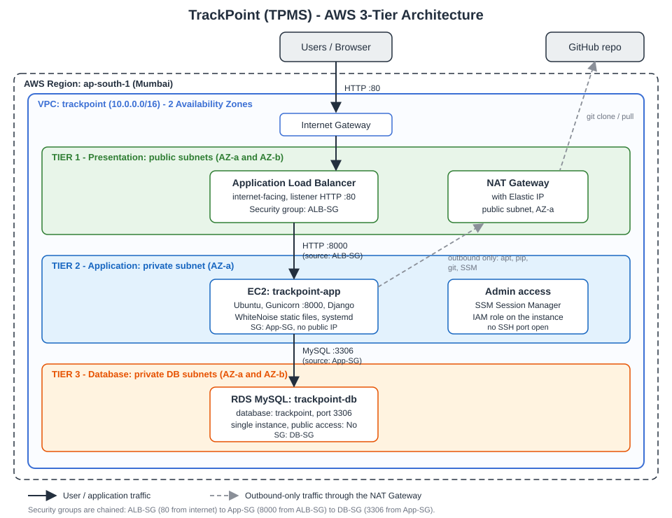

# Deploying a Django App on AWS with a 3-Tier Architecture

A step-by-step record of how I deployed **TrackPoint (TPMS)**, a Django Training and Placement Management System, on AWS using a classic 3-tier design:

| Tier | AWS service | Where it lives |
|---|---|---|
| 1. Presentation | Application Load Balancer | Public subnets |
| 2. Application | EC2 (Ubuntu, Gunicorn, Django) | Private subnet, no public IP |
| 3. Database | RDS MySQL | Private DB subnets |

Application source code: https://github.com/Basavaraj02-BD/Training-Placement-Management-System



---

## Table of contents

1. [What I built and why](#1-what-i-built-and-why)
2. [Prerequisites](#2-prerequisites)
3. [Step 1: Prepare the Django code](#3-step-1-prepare-the-django-code)
4. [Step 2: Create the VPC](#4-step-2-create-the-vpc)
5. [Step 3: Create the security groups](#5-step-3-create-the-security-groups)
6. [Step 4: Create the RDS database](#6-step-4-create-the-rds-database)
7. [Step 5: Launch the EC2 instance](#7-step-5-launch-the-ec2-instance)
8. [Step 6: Install and configure the app](#8-step-6-install-and-configure-the-app)
9. [Step 7: Run Gunicorn as a service](#9-step-7-run-gunicorn-as-a-service)
10. [Step 8: Create the target group and load balancer](#10-step-8-create-the-target-group-and-load-balancer)
11. [Step 9: Test](#11-step-9-test)
12. [Updating the app after new commits](#12-updating-the-app-after-new-commits)
13. [Problems I hit and how I fixed them](#13-problems-i-hit-and-how-i-fixed-them)
14. [Security notes](#14-security-notes)
15. [Cost and clean-up](#15-cost-and-clean-up)
16. [Future improvements](#16-future-improvements)
17. [What I learned](#17-what-i-learned)

---

## 1. What I built and why

The goal was an AWS project that separates a web application into three layers, so that:

- only the load balancer is reachable from the internet,
- the application server has no public IP and only accepts traffic from the load balancer,
- the database only accepts traffic from the application server.

This is enforced with a custom VPC, public and private subnets, and **chained security groups** (a security group as the traffic source instead of an IP range).

Notes on this particular build:

- Region: `ap-south-1` (Mumbai), 2 Availability Zones in the VPC.
- One EC2 instance and one single-AZ RDS instance (kept small to limit cost). A second AZ is configured at the network level (subnets and the DB subnet group) so high availability can be added later.
- One NAT Gateway (in a single AZ) so the private instance can download packages and pull code.
- Administration through **AWS Systems Manager Session Manager**, so no SSH port is open to the internet.

## 2. Prerequisites

- An AWS account and permission to create VPC, EC2, RDS, ELB and IAM resources.
- The Django project in a GitHub repository.
- The Django project should use environment variables for secrets (Step 1).

> Free-tier eligibility and prices change over time. Check the AWS pricing page and the cost estimate shown in the console before creating resources.

## 3. Step 1: Prepare the Django code

The original project used SQLite, `DEBUG=True` and a hardcoded secret key. Before deploying I changed three things.

**`requirements.txt`**: added a production server, static file handling and the MySQL driver:

```
gunicorn
whitenoise
mysqlclient
```

**`config/settings.py`**: read configuration from environment variables:

```python
import os

SECRET_KEY = os.environ.get('DJANGO_SECRET_KEY', 'dev-only-key')
DEBUG = os.environ.get('DJANGO_DEBUG', '0') == '1'
ALLOWED_HOSTS = os.environ.get('ALLOWED_HOSTS', '*').split(',')
CSRF_TRUSTED_ORIGINS = [o for o in os.environ.get('CSRF_ORIGINS', '').split(',') if o]

DATABASES = {
    'default': {
        'ENGINE': 'django.db.backends.mysql',
        'NAME': os.environ.get('DB_NAME', 'trackpoint'),
        'USER': os.environ.get('DB_USER', 'admin'),
        'PASSWORD': os.environ.get('DB_PASSWORD', ''),
        'HOST': os.environ.get('DB_HOST', ''),
        'PORT': os.environ.get('DB_PORT', '3306'),
    }
}
```

and added WhiteNoise right after `SecurityMiddleware`:

```python
MIDDLEWARE = [
    'django.middleware.security.SecurityMiddleware',
    'whitenoise.middleware.WhiteNoiseMiddleware',
    # ... the rest unchanged
]
```

**`.gitignore`**: make sure `db.sqlite3`, `venv/`, `.env`, `media/` and `staticfiles/` are ignored. Commit and push to GitHub.

## 4. Step 2: Create the VPC

**VPC console, Create VPC, "VPC and more":**

| Setting | Value |
|---|---|
| Name tag | `trackpoint` |
| IPv4 CIDR | `10.0.0.0/16` |
| Availability Zones | 2 |
| Public subnets | 2 |
| Private subnets | 4 (two for the app tier, two for the DB tier) |
| NAT gateways | In 1 AZ |
| DNS hostnames and DNS resolution | Enabled |

Afterwards, rename the subnets (for example `app-1a`, `app-1b`, `db-1a`, `db-1b`) so they are easy to tell apart.

The wizard also creates the internet gateway and route tables:

- public subnets: `0.0.0.0/0` goes to the internet gateway,
- private subnets: `0.0.0.0/0` goes to the NAT gateway.

## 5. Step 3: Create the security groups

VPC console, Security groups, Create. Always select the `trackpoint` VPC.

| Name | Inbound rule | Source |
|---|---|---|
| `TrackPoint-ALB-SG` | HTTP 80 | `0.0.0.0/0` |
| `TrackPoint-App-SG` | Custom TCP 8000 | `TrackPoint-ALB-SG` |
| `TrackPoint-DB-SG` | MySQL/Aurora 3306 | `TrackPoint-App-SG` |

Use the **security group** as the source (not an IP range). That is what makes the tiers properly isolated.

## 6. Step 4: Create the RDS database

1. **DB subnet group**: RDS, Subnet groups, Create. VPC `trackpoint`, both AZs, and the two **db** subnets only.
2. RDS, Create database, Standard create, **MySQL**.
3. Single instance, small burstable instance class, no Multi-AZ.
4. DB identifier `trackpoint-db`, master username `admin`, and a password you store safely.
5. Connectivity: VPC `trackpoint`, the DB subnet group above, **Public access: No**, security group `TrackPoint-DB-SG` (remove `default`).
6. **Additional configuration, Initial database name: `trackpoint`**. If you skip this, RDS creates no database and Django fails with "Unknown database".
7. Create. Copy the **endpoint** from the Connectivity and security tab.

## 7. Step 5: Launch the EC2 instance

**IAM role first:** IAM, Roles, Create, trusted entity EC2, attach `AmazonSSMManagedInstanceCore`, name it `trackpoint-ec2-ssm`.

**EC2, Launch instance:**

| Setting | Value |
|---|---|
| Name | `trackpoint-app` |
| AMI | Ubuntu Server LTS (mine used Python 3.14) |
| Network | VPC `trackpoint`, subnet `app-1a` |
| Auto-assign public IP | **Disable** |
| Security group | `TrackPoint-App-SG` |
| IAM instance profile | `trackpoint-ec2-ssm` |
| Key pair | Required by the console in my case; created `trackpoint-key` (not used, since access is through Session Manager) |

Connect with **EC2, select the instance, Connect, Session Manager**. If the tab is greyed out, wait a few minutes and check that the IAM role is attached and the private route table has the NAT route.

Session Manager logs in as `ssm-user`, so switch to the app user:

```bash
sudo -iu ubuntu
```

## 8. Step 6: Install and configure the app

**Install system packages:**

```bash
sudo apt update
sudo apt install -y python3-venv python3-dev git build-essential pkg-config libmysqlclient-dev netcat-openbsd
```

**Clone the code and install Python dependencies:**

```bash
sudo mkdir -p /opt/app && sudo chown ubuntu:ubuntu /opt/app
git clone https://github.com/<your-username>/<your-repo>.git /opt/app
cd /opt/app
python3 -m venv venv
source venv/bin/activate
pip install --upgrade pip
pip install -r requirements.txt
```

`manage.py` must sit directly in `/opt/app`. If your repo has the project in a subfolder, adjust the paths below.

**Test the network path to RDS:**

```bash
nc -zv <RDS-ENDPOINT> 3306
```

It should print `succeeded`.

**Create the environment file** `/etc/tpms.env` (use `deploy/tpms.env.example` as the template):

```bash
sudo vim /etc/tpms.env      # or nano
sudo chmod 644 /etc/tpms.env
```

Generate a secret key with:

```bash
python3 -c "import secrets;print(secrets.token_urlsafe(50))"
```

> Tip: pasting multi-line blocks (heredocs) into Session Manager can break. Using an editor such as vim or nano is more reliable. Check the file without printing secrets: `sudo cut -d= -f1 /etc/tpms.env` should list the 8 variable names.

**Migrate, seed and collect static files:**

```bash
cd /opt/app
source venv/bin/activate
set -a; source /etc/tpms.env; set +a
python manage.py migrate
python manage.py seed_demo
python manage.py collectstatic --noinput
```

## 9. Step 7: Run Gunicorn as a service

Create `/etc/systemd/system/tpms.service` (see `deploy/tpms.service`), then run the commands one at a time:

```bash
sudo systemctl daemon-reload
sudo systemctl enable --now tpms
sudo systemctl status tpms --no-pager
curl -I http://localhost:8000/login/
```

Expected: `active (running)` and `HTTP/1.1 200 OK`.

## 10. Step 8: Create the target group and load balancer

**Target group** (EC2, Target groups, Create):

- Target type: Instances
- Name `trackpoint-tg`, protocol HTTP, port `8000`, VPC `trackpoint`
- Health check path: `/login/`
- Register `trackpoint-app` on port `8000` (tick the instance, then "Include as pending below")

**Application Load Balancer** (EC2, Load balancers, Create):

- Scheme: **Internet-facing**
- VPC `trackpoint`, both **public** subnets
- Security group `TrackPoint-ALB-SG`
- Listener HTTP 80, forward to `trackpoint-tg`

Wait until the ALB is `Active` and the target shows `healthy`.

## 11. Step 9: Test

Open `http://<alb-dns-name>` in a browser (use `http://`, since there is no HTTPS listener) and log in. Then verify the isolation:

- EC2 has no public IPv4 address.
- RDS has Public access set to No.
- The target group shows `healthy`.
- Security group rules match the table in Step 3.

## 12. Updating the app after new commits

The server runs its own copy of the code, so pushing to GitHub does not update it automatically. On the instance:

```bash
sudo -iu ubuntu
cd /opt/app
git pull
# if requirements.txt changed:  source venv/bin/activate && pip install -r requirements.txt
# if models changed:            python manage.py migrate   (with the env loaded)
# if static files changed:      python manage.py collectstatic --noinput
sudo systemctl restart tpms
```

`deploy/deploy.sh` wraps all of this in one script. Hard-refresh the browser (`Ctrl + Shift + R`) afterwards because CSS and JS may be cached.

## 13. Problems I hit and how I fixed them

| Problem | Cause | Fix |
|---|---|---|
| RDS could not be reached from EC2, and the security group dropdown only showed `default` | The first attempt had RDS in the default VPC and EC2 in a custom VPC. Two VPCs cannot talk without peering | Rebuilt everything from scratch with EC2, RDS and the ALB in one VPC |
| `apt` said `mysql-client-core-8.0` has no installation candidate | That optional package is not available on the newer Ubuntu release, and one missing package makes `apt` install nothing | Removed it from the command; `nc` is enough to test connectivity |
| `git push` rejected with "fetch first" | The remote had a commit that was not in the local clone | `git pull --rebase`, then `git push` |
| `git pull --rebase` said "unstaged changes" | An edited `requirements.txt` was not committed | Committed the file first |
| `git rm --cached` failed with "pathspec did not match" | `db.sqlite3` was never tracked | Nothing to remove; `.gitignore` already covered it |
| Environment file contained the wrong text | A heredoc pasted into Session Manager was swallowed by the terminal | Wrote the file with an editor instead and checked variable names with `cut` |
| Browser showed `ERR_CONNECTION_TIMED_OUT` for the ALB URL | Request never reached the ALB, so a network issue (scheme, ALB security group, wrong subnets or listener), not Django | Checked scheme is internet-facing, ALB-SG allows port 80, subnets have a route to the internet gateway, and a listener exists |
| Site did not show new commits | Code on the server is a separate copy | `git pull` on the instance and restart the service |

## 14. Security notes

- Never commit `/etc/tpms.env`, the `.pem` key, or database passwords.
- Change or remove the demo user passwords if the site stays online.
- `ALLOWED_HOSTS=*` is convenient because ALB health checks use the instance IP as the host header. Tighten it to the ALB DNS name and the instance private IP for anything beyond a demo.
- No SSH port is needed; use Session Manager.
- The environment file uses mode `644` so the service user can read it. For real workloads, use AWS Secrets Manager or SSM Parameter Store instead.
- The site is HTTP only. Add HTTPS for anything real.

## 15. Cost and clean-up

The NAT Gateway, Application Load Balancer and RDS instance all cost money while they exist. Check the AWS pricing pages for current rates. When finished, take screenshots and delete in this order:

1. Load balancer, then target group
2. EC2 instance
3. RDS instance (skip the final snapshot if you do not need it), then the DB subnet group
4. NAT gateway, then release its Elastic IP
5. The VPC (this removes the subnets, route tables and internet gateway)
6. Leftover security groups, the IAM role and the key pair

## 16. Future improvements

- HTTPS with a Route 53 domain and an ACM certificate on the ALB
- Auto Scaling Group with two instances across both AZs
- RDS Multi-AZ
- Secrets Manager for credentials
- S3 (with `django-storages`) for uploaded media, so it is shared across instances
- CloudWatch alarms and AWS WAF
- CI/CD with GitHub Actions or AWS CodeDeploy
- Infrastructure as code (CloudFormation or Terraform)

## 17. What I learned

- How public and private subnets, route tables, an internet gateway and a NAT gateway fit together.
- Why security groups should reference other security groups.
- How an ALB, target group and health check work together.
- Running Django in production with Gunicorn, WhiteNoise and systemd.
- Debugging by layer: network first (`nc`, security groups, routes), then the service, then the application.

## Repository layout

```
.
├── README.md
├── docs/
│   └── architecture.svg
└── deploy/
    ├── tpms.service        # systemd unit for Gunicorn
    ├── tpms.env.example    # environment variable template
    └── deploy.sh           # one-command redeploy
```
